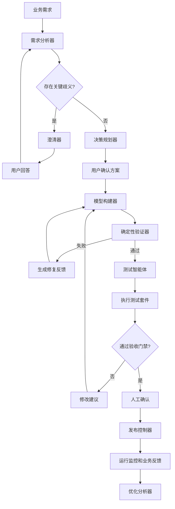

# 智能决策平台整体设计方案

## 1. 背景

当前系统已经实现以下核心链路：

- 用户通过自然语言描述业务决策需求。
- 大模型生成结构化 DSL YAML。
- 服务端校验 DSL 的元素、引用、类型和决策依赖。
- DSL 转换为 DMN XML。
- 内置 DMN/FEEL 引擎解析、编译并执行模型。
- 生成失败时将错误反馈给大模型并自动修复。
- 支持现有 DSL 的增量修改、模型核验和测试执行。

现阶段产品的主要能力集中在“自然语言到可执行 DMN”的生成过程。下一阶段应将其升级为覆盖需求分析、方案确认、模型构建、业务验收、发布运行和持续优化的智能决策平台。

## 2. 建设目标

### 2.1 产品目标

- 让业务用户不需要掌握 DSL、DMN XML 或 FEEL 语法即可完成决策建模。
- 将复杂建模过程收敛为少量明确步骤，降低学习和操作成本。
- 在提高大模型智能度的同时，保证模型生成、修改和发布过程可控、可验证、可追溯。
- 支持从一次性模型生成演进到决策项目、版本、测试、发布和监控的完整生命周期。

### 2.2 技术目标

- 继续使用现有 DSL 作为唯一规范中间表示。
- 继续使用确定性的 DSL、DMN 和 FEEL 校验器作为质量门禁。
- 将当前单一生成智能体拆分为可编排、可恢复、可观测的阶段化工作流。
- 所有智能体输出采用结构化协议，不依赖自由文本驱动核心业务流程。
- 支持失败重试、阶段检查点、人工确认和版本回滚。

## 3. 设计原则

1. 业务语言优先：默认展示业务目标、输入、规则、结果和解释，隐藏底层技术细节。
2. 先规划后生成：先确认决策方案，再生成完整模型，减少大范围返工。
3. 确定性校验优先：大模型负责理解和建议，校验器负责判断模型是否可接受。
4. 最小必要澄清：只向用户询问会实质影响决策结果的问题。
5. 增量修改优先：修改模型时使用结构化补丁，避免完整重写导致内容丢失。
6. 人在回路：高风险修改和正式发布必须经过人工确认。
7. 全程可解释：生成、修改、测试、执行和发布均保留原因、依据和审计信息。

## 4. 目标用户体验

用户主要经历以下五个阶段：

```text
描述目标
  -> AI 提取决策需求
  -> 询问关键歧义
  -> 用户确认业务方案
  -> 生成并自动修复模型
  -> 自动生成和执行验收测试
  -> 用户确认
  -> 发布决策服务
  -> 运行监控与持续优化
```

页面主操作随阶段变化：

```text
分析需求 -> 确认方案 -> 生成模型 -> 通过验收 -> 发布
```

DSL YAML、DMN XML、FEEL 表达式和执行日志放入“高级信息”区域，默认不要求业务用户直接处理。

## 5. 产品信息架构

### 5.1 决策项目

每个业务决策作为一个独立项目管理，包括：

- 项目名称和业务目标。
- 负责人、协作者和审批人。
- 当前草稿和已发布版本。
- 输入、决策、业务知识模型和决策服务。
- 测试案例、验收结果和发布记录。
- 线上运行指标和业务反馈。

### 5.2 工作台布局

- 顶部：项目名称、当前版本、生命周期状态、保存和发布操作。
- 左侧：业务目标、对话记录、澄清问题和变更指令。
- 中间：输入、决策、BKM、决策服务及依赖关系组成的业务模型。
- 右侧：风险提示、模型校验、测试覆盖率和智能修改建议。
- 底部抽屉：DSL YAML、DMN XML、FEEL、执行日志等高级内容。

### 5.3 核心操作

- 新建决策：输入一段业务描述，系统生成需求摘要和决策方案。
- 修改元素：选中元素后直接输入“将阈值改为 0.5”一类局部指令。
- 解释规则：查看规则用途、输入来源、命中条件和输出影响。
- 运行测试：使用自动生成或人工输入的业务案例执行模型。
- 对比版本：查看新增、修改、删除、风险变化和测试差异。
- 发布服务：通过验收门禁后发布不可变版本。
- 回滚版本：从历史已发布版本创建新草稿，重新验收和发布后再切换线上服务。

## 6. 智能体架构

采用阶段化状态机编排，不使用多个自由对话智能体无约束讨论。

| 智能模块 | 主要职责 | 结构化输出 |
| --- | --- | --- |
| 需求分析器 | 提取目标、输入、输出、约束、术语和隐含假设 | `DecisionBrief` |
| 澄清器 | 识别影响结果的歧义并生成必要问题 | `Clarification[]` |
| 决策规划器 | 设计决策、BKM、决策服务和依赖关系 | `DecisionPlan` |
| 模型构建器 | 创建 DSL 或生成局部模型补丁 | `Definitions` / `ModelPatch` |
| 确定性验证器 | 执行 DSL、引用、类型、FEEL 和 DMN 编译校验 | `VerificationReport` |
| 测试智能体 | 生成正常、边界、冲突和异常测试案例 | `TestSuite` |
| 解释器 | 将执行路径和命中规则转换为业务解释 | `DecisionExplanation` |
| 发布控制器 | 执行审批、版本固化、发布和回滚 | `ReleaseRecord` |
| 优化分析器 | 基于运行反馈发现规则缺口和改进机会 | `OptimizationProposal` |

### 6.1 编排流程



### 6.2 状态与检查点

每次智能运行保存以下信息：

- 当前阶段和阶段输入。
- 使用的模型、提示模板版本和请求参数。
- 结构化输出和校验结果。
- 重试次数、错误类型和修复内容。
- 用户确认、拒绝或修改记录。

服务重启、网络断开或模型调用失败后，可以从最近检查点继续执行，而不是从头生成。

## 7. 核心结构化协议

### 7.1 DecisionBrief

需求分析器输出业务需求摘要：

```json
{
  "name": "RetailLoanApproval",
  "goal": "判断零售贷款申请是否可批准",
  "inputs": [],
  "outputs": [],
  "constraints": [],
  "terms": [],
  "assumptions": [],
  "ambiguities": [],
  "riskLevel": "medium"
}
```

### 7.2 DecisionPlan

规划器只描述模型结构，不直接生成完整表达式：

```json
{
  "decisions": [],
  "businessKnowledgeModels": [],
  "decisionServices": [],
  "dependencies": [],
  "defaults": [],
  "acceptanceCriteria": []
}
```

### 7.3 ModelPatch

修改模式使用明确操作代替完整重写：

```json
{
  "baseVersion": 3,
  "operations": [
    {
      "op": "update",
      "elementType": "decision",
      "element": "RiskGrade",
      "path": "logic.rules[0].inputEntries[2]",
      "before": "> 0.55",
      "after": "> 0.50",
      "reason": "用户要求降低高风险阈值"
    }
  ]
}
```

补丁由服务端应用到现有 `Definitions`，之后执行完整校验。大模型不能直接覆盖未列入补丁的元素。

### 7.4 VerificationReport

```json
{
  "versionId": 12,
  "status": "passed",
  "total": 14,
  "passed": 14,
  "failed": 0,
  "boundaryCases": 6,
  "gates": [],
  "cases": [],
  "findings": []
}
```

`findings` 统一承载规则冲突、重叠、不可达和覆盖缺口，避免为每类发现重复增加顶层字段。当前静态分析确定性支持全匹配、数值比较、精确数值、数值区间和相同字符串条件。复杂 `not(...)`、逗号 OR、字符串枚举以及日期时间区间暂不展开，采用不误报、允许漏报的保守策略。

## 8. 智能度提升机制

### 8.1 需求理解和最小澄清

系统应识别以下常见歧义：

- 输入单位不明确。
- 输出类型或状态集合不明确。
- 多条规则同时满足时的处理方式不明确。
- 缺失值和异常值处理方式不明确。
- 阈值边界是否包含端点不明确。
- 决策依赖或优先级不明确。

只有会改变模型执行结果的问题才阻塞生成。其他事项使用明确默认值，并在方案确认页中展示假设。

### 8.2 候选方案评估

针对复杂或高风险模型，可以生成多个候选规划，并按以下指标评估：

- 是否通过 DSL、DMN 和 FEEL 编译。
- 规则覆盖率和边界覆盖率。
- 是否存在冲突、重叠或不可达规则。
- 决策依赖复杂度。
- 业务验收案例通过率。
- 模型可解释性和维护成本。

系统默认推荐得分最高的方案，同时允许用户查看差异。

### 8.3 自动测试生成

测试智能体至少生成以下类型的案例：

- 正常业务路径。
- 每个阈值的上下边界和等值边界。
- 每种输出结果至少一个命中案例。
- 多条规则可能同时命中的冲突案例。
- 无规则命中的案例。
- 缺失输入、空值和错误类型。
- 自定义数据类型约束和枚举值。
- 决策依赖失败和 BKM 调用异常。

测试案例先由智能体提出，再由确定性执行引擎运行。智能体不能自行声明测试通过。

### 8.4 企业知识增强

后续可接入以下知识来源：

- 企业业务术语和字段目录。
- 历史决策模型和行业模板。
- 制度、合同、监管规则和操作手册。
- 已发布决策服务及其输入输出契约。
- 人工标注的优秀案例和纠错记录。

检索结果必须保留来源、版本和有效时间。外部知识只能作为建模依据，不能绕过审批和发布门禁。

### 8.5 可解释执行

每次模型执行应返回：

- 使用的模型和版本。
- 标准化后的输入。
- 实际执行的依赖决策。
- 每个决策命中的规则。
- 中间结果和最终结果。
- 未命中、默认输出或失败原因。
- 面向业务用户的自然语言解释。

自然语言解释基于确定性执行轨迹生成，不能脱离真实命中结果自由推断。

当前状态：已完成基础版。临时模型测试和持久化业务验收共用统一轨迹构建器，输出模型与版本、标准化输入、依赖执行顺序、逻辑类型、命中规则、中间结果、完整输出和诊断信息。解释文本由确定性模板生成，明确区分规则命中、默认输出、无规则命中、依赖失败跳过和执行失败，不调用大模型。

## 9. 验收与发布门禁

模型进入发布状态前必须满足：

- DSL 解析和语义校验通过。
- DMN XML 生成、解析和编译通过。
- 所有 FEEL 表达式编译通过。
- 必填业务验收案例全部通过。
- 不存在未确认的高风险警告。
- 所有删除、重命名和接口变更已经确认。
- 指定审批人已经批准。

发布版本必须不可变。后续修改创建新版本；回滚同样复制任意历史已发布版本为新草稿，不直接修改历史记录或线上发布指针。

## 10. 数据模型设计

PostgreSQL 建议新增以下核心表。

### 10.1 decision_projects

保存决策项目基本信息：

- `id`
- `name`
- `description`
- `owner_id`
- `risk_level`
- `current_draft_version_id`
- `published_version_id`
- `created_at`
- `updated_at`

### 10.2 decision_versions

保存模型版本和生命周期状态：

- `id`
- `project_id`
- `version_number`
- `status`
- `base_version_id`
- `rollback_source_version_id`
- `rollback_reason`
- `change_summary`
- `created_by`
- `created_at`
- `reviewed_by`
- `reviewed_at`

状态建议：

```text
Draft -> Validated -> Reviewed -> Published -> Retired
```

### 10.3 decision_artifacts

- `version_id`
- `decision_brief_json`
- `decision_plan_json`
- `dsl_yaml`
- `dmn_xml`
- `compiled_artifact`
- `verification_report_json`
- `content_hash`

### 10.4 decision_test_cases

- `id`
- `version_id`
- `name`
- `category`
- `input_json`
- `expected_output_json`
- `actual_output_json`
- `execution_trace_json`
- `status`
- `source`
- `approved_by`
- `approved_at`
- `created_at`
- `updated_at`

### 10.5 agent_runs

- `id`
- `project_id`
- `version_id`
- `stage`
- `status`
- `model`
- `prompt_version`
- `input_json`
- `output_json`
- `retry_count`
- `error_json`
- `started_at`
- `finished_at`

### 10.6 decision_runs

- `id`
- `project_id`
- `version_id`
- `service_name`
- `service_id`
- `input_json`
- `output_json`
- `execution_trace_json`
- `duration_ms`
- `status`
- `executed_by`
- `executed_at`

敏感输入需要脱敏、加密或只保存摘要。

### 10.7 decision_feedback

- `id`
- `decision_run_id`
- `expected_result_json`
- `actual_business_result_json`
- `feedback_type`
- `comment`
- `created_by`
- `created_at`

### 10.8 audit_events

记录创建、修改、测试、审批、发布、回滚和权限操作，满足可追溯要求。

- `id`
- `project_id`
- `version_id`
- `event_type`
- `actor_username`
- `summary`
- `details_json`
- `created_at`

`decision_versions` 同时保存 `rollback_source_version_id` 和 `rollback_reason`。回滚来源与业务原因属于版本固有元数据，审计事件则记录操作者、时间和生命周期上下文，两者不可互相替代。

## 11. 服务端架构建议

```text
HTTP / SSE API
    |
Decision Workflow Orchestrator
    |-- Requirement Analyzer
    |-- Clarification Manager
    |-- Decision Planner
    |-- DSL Builder / Patch Applier
    |-- Test Generator
    |-- Explanation Generator
    |
Deterministic Decision Core
    |-- DSL Parser and Validator
    |-- DMN Generator and Parser
    |-- FEEL Compiler
    |-- DMN Executor
    |
Persistence and Governance
    |-- Projects and Versions
    |-- Agent Checkpoints
    |-- Test Suites
    |-- Release and Audit
```

现有模块可按以下方式演进：

- `src/nl_dsl/agent.rs`：拆分为编排器和多个阶段服务。
- `src/nl_dsl/dsl.rs`：继续作为规范 DSL 数据模型。
- `src/nl_dsl/dmn.rs`：继续负责 DSL 到 DMN XML 的确定性转换。
- `src/dmn` 和 `src/feel`：继续作为编译和执行内核。
- `src/api.rs`：增加项目、版本、规划、测试、发布和执行轨迹接口。
- `src/components.rs`：从单页生成工作台演进为项目化阶段工作流。

## 12. API 演进建议

建议新增以下接口：

```text
POST   /api/projects
GET    /api/projects
GET    /api/projects/{project_id}

POST   /api/projects/{project_id}/analyze
POST   /api/projects/{project_id}/clarifications/{id}/answer
POST   /api/projects/{project_id}/plan
POST   /api/projects/{project_id}/plan/confirm

POST   /api/projects/{project_id}/versions
GET    /api/projects/{project_id}/versions
GET    /api/projects/{project_id}/versions/{version_id}
POST   /api/projects/{project_id}/versions/{version_id}/patch
POST   /api/projects/{project_id}/versions/{version_id}/verify

POST   /api/projects/{project_id}/versions/{version_id}/tests/generate
POST   /api/projects/{project_id}/versions/{version_id}/tests/run

POST   /api/projects/{project_id}/versions/{version_id}/review
POST   /api/projects/{project_id}/versions/{version_id}/publish
POST   /api/projects/{project_id}/versions/{version_id}/rollback
GET    /api/projects/{project_id}/audit-events

POST   /api/decision-services/{service}/evaluate
GET    /api/decision-runs/{run_id}/explanation
```

长时间运行的分析、生成和测试操作继续使用 SSE 推送阶段事件。

## 13. 非功能要求

### 13.1 安全

- API 密钥只保存在服务端。
- JWT 过期统一退出并清理前端状态。
- 项目、版本、发布和执行记录进行权限隔离。
- 敏感输入和运行数据支持脱敏与留存策略。
- 所有发布和回滚操作进入审计日志。

### 13.2 可观测性

- 记录各智能阶段耗时、重试次数、Token 消耗和失败类型。
- 记录 DSL、DMN、FEEL 各校验阶段的通过率。
- 统计智能建议采纳率、人工修改率和测试通过率。
- 使用关联 ID 串联一次请求中的模型调用、编译、测试和发布记录。

### 13.3 性能

- 对同一版本的编译产物进行缓存。
- 测试套件支持并行执行。
- 大模型调用设置超时、取消和限流。
- 长流程通过检查点避免重复调用已完成阶段。

## 14. 分阶段实施计划

### 第一阶段：受控智能建模

目标是解决“一次生成不够可靠、修改容易误伤、缺少版本”的问题。

- 增加 `DecisionBrief` 需求分析。
- 增加关键歧义澄清。
- 增加决策方案确认页面。
- 引入决策项目和版本持久化。
- 使用 `ModelPatch` 处理增量修改。
- 增加版本差异展示。
- 增加规则冲突、不可达规则和边界检查。
- 增加发布前基础门禁。

当前状态：已完成。规则分析已覆盖 `UNIQUE` 重叠、`ANY` 输出冲突、`FIRST` 不可达规则和无兜底覆盖缺口；覆盖缺口作为警告，其余高风险发现阻止发布。

### 第二阶段：智能测试与决策服务

- 自动生成业务和边界测试。
- 建立测试套件和人工验收机制。
- 输出确定性执行轨迹和自然语言解释。
- 支持发布决策服务。
- 支持版本回滚和审计。
- 提供行业模板和历史模型复用。

当前状态：已完成基础版。测试套件支持按可反解决策表规则确定性生成持久化业务候选案例，覆盖数值比较/区间、字符串与布尔常量、枚举和普通 OR 条件；候选输入必须实际命中目标规则并成功执行，复杂 FEEL 和不可达规则会明确跳过。生成结果不会自动批准，仍需业务人员核对。人工验收、确定性轨迹、自然语言解释、发布服务、版本回滚、项目审计和模型库复用也已落地。

### 第三阶段：知识增强与持续优化

- 接入企业术语、字段和制度知识库。
- 支持知识来源引用和有效期管理。
- 收集线上运行反馈和实际业务结果。
- 分析规则覆盖、结果分布和异常趋势。
- 生成优化建议，由人工确认后进入新版本。
- 根据任务类型选择不同模型和推理配置。

当前状态：已完成。平台已提供用户级企业术语、字段目录和制度政策知识库，支持来源、版本、启用/归档状态与生效/失效日期；知识需显式绑定项目，只有当前有效来源由服务端注入需求分析、方案规划和 DSL 生成。智能运行记录保存所用引用，新版本由服务端重新校验并固化引用快照，回滚与模型复用继承历史快照，知识变更不会改写旧版本。线上决策调用支持业务关联号，成功运行可回填实际业务结果、发生时间、人工判定和说明，回填人、时间及项目审计事件同步保存。平台按当前发布版本隔离聚合最近 30 个 UTC 自然日的运行轨迹并生成确定性异常。异常可生成带来源版本、证据和分析快照的优化建议；建模者确认后仅创建未复核的新草稿，驳回和确认都进入审计记录，旧建议在发布版本或草稿变化后不可确认。需求分析、方案规划、DSL 生成和 ModelPatch 也支持独立的服务端模型与推理配置，未设置时回退全局配置；DeepSeek thinking 模式继续避免强制工具选择。所有建议仍必须经过模型修改、技术核验、业务验收、独立复核和发布审批。

## 15. 第一阶段推荐任务拆分

1. 设计并实现项目、版本和智能运行数据表。
2. 将当前生成接口包装为可持久化的工作流执行记录。
3. 定义 `DecisionBrief`、`Clarification`、`DecisionPlan` 和 `ModelPatch` Rust 类型。
4. 实现需求分析和方案规划的结构化大模型调用。
5. 实现服务端补丁应用器和补丁校验器。
6. 增加决策项目列表、项目工作台和方案确认视图。
7. 增加版本差异、风险摘要和变更确认视图。
8. 增加自动边界测试和发布门禁。
9. 为新流程增加 API、编排、数据库和前端测试。

当前实现进度：第一、第二、第三阶段核心任务已落地，包含阶段化需求与方案确认、增量补丁、版本差异和风险确认、确定性基础/契约/边界执行、规则冲突与覆盖分析、自动业务候选案例、人工批准、确定性执行轨迹、发布决策服务、版本回滚、项目审计、行业模板和历史模型复用，企业术语、字段、制度知识源的项目绑定、有效期治理、智能上下文注入和版本引用快照，线上运行反馈和 30 日分析，可追溯优化建议与人工确认草稿流程，以及按任务类型配置的模型和推理策略。

## 16. 成功指标

- 首次生成后无需人工修改即可通过技术校验的比例。
- 从需求输入到业务方案确认的平均时间。
- 每次模型修改影响的非目标元素数量。
- 自动测试发现问题的数量和有效率。
- 发布前发现规则冲突和边界缺口的比例。
- 决策解释被用户接受或纠正的比例。
- 已发布模型的回滚次数和线上错误率。
- 用户直接编辑 DSL 或 DMN XML 的操作比例持续下降。

## 17. 结论

下一代方案的重点不是继续增强“一次性生成完整 DSL”的能力，而是建立一个结构化、受控、可恢复的决策工程闭环：

```text
业务需求
  -> 结构化理解
  -> 关键澄清
  -> 方案规划
  -> 确定性生成与校验
  -> 自动测试
  -> 人工验收
  -> 版本发布
  -> 运行反馈
  -> 持续优化
```

现有 DSL、DMN 和 FEEL 能力可以继续作为稳定内核。主要新增工作集中在智能体编排、项目与版本数据模型、测试与发布治理，以及更贴近业务用户的阶段化交互。
